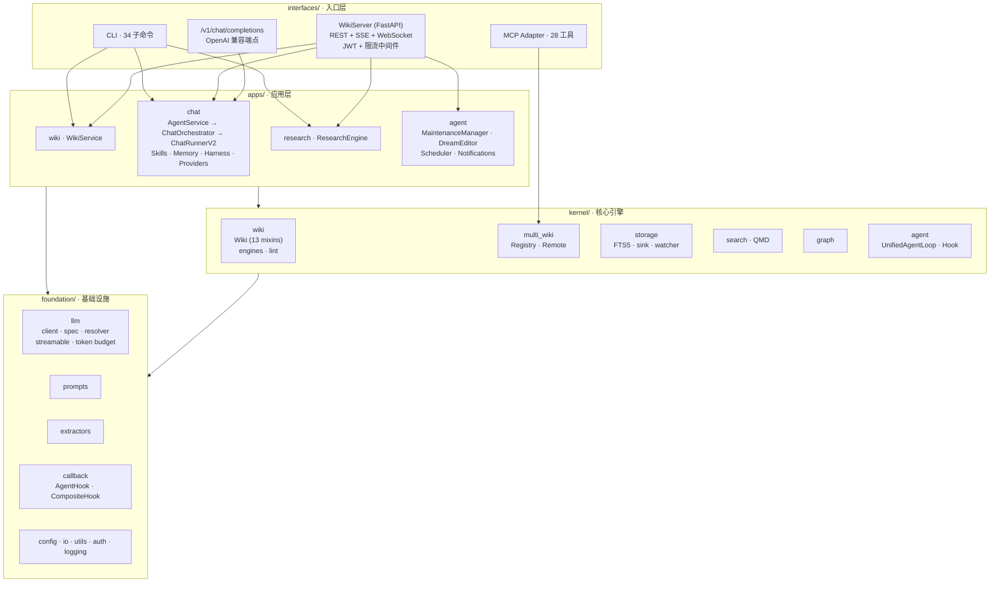

# llmwikify Architecture

> Technical architecture for developers.
> **Version:** 0.40.3 | **Last updated:** 2026-10-22 | **Tests:** 4940 Python collected
>
> Diagrams & flow charts live in [docs/architecture/overview.md](docs/architecture/overview.md).

---

## Overview

**llmwikify** is a persistent, LLM-maintained knowledge base with chat, research, and agent capabilities. The codebase is organised into four cooperating layers:

| Layer | Responsibility |
|-------|----------------|
| **`kernel/`** | Core engines — wiki domain model, multi-wiki, search, knowledge graph, storage |
| **`foundation/`** | LLM client, prompt registry, extractors, configuration, IO |
| **`apps/`** | Application services — wiki, chat (ChatRunner + Skills), research, agent runtime + self-maintenance |
| **`interfaces/`** | CLI, MCP, FastAPI server (REST + MCP + Web UI), Web bundle |

### Design Principles

1. **Zero domain assumptions** — no hardcoded concepts, user-configurable exclusions
2. **Configuration-driven** — `.wiki-config.yaml` + `~/.llmwikify/llmwikify.json`
3. **Single message source-of-truth** — business data binds to `assistant` messages
4. **Pure tool design** — works for any domain
5. **Knowledge compounding** — query answers are saved back to the wiki
6. **User control** — watch defaults to notify-only, analysis is opt-in
7. **Stay involved** — LLM suggests, human decides (Karpathy principle)

---

## Module Structure

```
src/llmwikify/
├── __init__.py
├── __main__.py
│
├── kernel/                       # Core engines
│   ├── wiki/
│   │   ├── wiki.py               # Wiki orchestrator (composes 13 mixins)
│   │   ├── protocols.py          # Typed protocols
│   │   ├── constants.py
│   │   ├── prompt_registry.py
│   │   ├── mixins/
│   │   │   ├── core/             # init.py, schema.py, utility.py
│   │   │   ├── io/               # page_io.py, link.py, ingest.py, source_analysis.py
│   │   │   └── analysis/         # lint.py, llm.py, query.py, relation.py, status.py, synthesis.py
│   │   ├── engines/              # analyzer.py, relation.py, synthesis.py
│   │   └── lint/                 # rule-based lint engine + rules/ (8 rules)
│   │
│   ├── multi_wiki/               # Multi-wiki registry
│   │   ├── registry.py
│   │   ├── instance.py
│   │   ├── discovery.py
│   │   └── remote.py             # HTTP client for remote llmwikify
│   │
│   ├── search/                   # QMD hybrid search client
│   │   ├── qmd_client.py
│   │   └── qmd_index.py
│   │
│   ├── graph/                    # Knowledge graph
│   │   ├── analyzer.py           # PageRank, communities, suggestions
│   │   ├── export.py             # HTML / SVG / GraphML
│   │   └── visualizer.py
│   │
│   ├── storage/                  # Persistence
│   │   ├── backend.py
│   │   ├── index.py              # FTS5 + references + relations
│   │   ├── query_sink.py
│   │   └── watcher.py            # Filesystem watcher
│   │
│   ├── agent/                    # Generic agent framework (UnifiedAgentLoop /
│   │                             # StepHandler / UnifiedHook / spec /
│   │                             # execution_context / steps/ / codegen_pipeline)
│   ├── codegen/                  # LLM code generation (extract/validate/execute)
│   └── principle_checker.py      # Prompt principle compliance
│
├── foundation/                   # Cross-cutting primitives
│   ├── config.py / db.py / io.py / logging.py / migration.py
│   ├── llm_client.py             # DEPRECATED shim → llm/base (compat)
│   ├── auth/                     # JWT secret (OS keyring) + verification
│   ├── callback/                 # AgentHook (13 hook points) + CompositeHook
│   │   └── integrations/         # WikiHook / WikiDreamSyncHook / AutoIngestHook
│   ├── llm/
│   │   ├── base.py               # LLMClient + process-level client memo
│   │   ├── client.py             # build_llm_client + load_llm_config
│   │   ├── spec.py               # LLMSpec (LAL)
│   │   ├── resolver.py           # from_spec / inheritance
│   │   ├── streamable.py         # StreamableLLMClient (streaming + tools)
│   │   ├── connection.py         # RetryConfig / backoff / _post_with_retry_*
│   │   ├── sse.py                # SSE line parse + tool-call accumulation
│   │   ├── wire.py               # thinking / role alternation / validate
│   │   ├── token_budget.py / token_estimator.py / budget_decorator.py
│   │   ├── context_windows.py / provider_models.py / errors.py
│   │   └── providers.yaml        # Provider metadata single source of truth
│   ├── prompts/
│   │   ├── prompt_registry.py    # YAML + Jinja2 templates with overrides
│   │   └── _defaults/            # Built-in prompts
│   ├── extractors/               # text / pdf / web / youtube / markitdown
│   └── templates/
```


```
├── apps/                         # Application services
│   ├── db.py / db_base.py        # AppDatabase (shared agent DB)
│   ├── wiki/
│   │   ├── service.py            # Wiki application service (multi-wiki facade)
│   │   └── db.py
│   │
│   ├── chat/                     # Chat agent + Skills
│   │   ├── base.py / session.py / state.py / command_router.py
│   │   ├── config.py / config_manager.py / prompts.py
│   │   ├── config_defaults.yaml  # Chat business defaults
│   │   ├── db_migrations.py / engine_helpers.py
│   │   ├── analyzer.py / reasoning_checker.py / retry_managers.py
│   │   ├── clarifier.py / gatherer.py / synthesizer.py
│   │   ├── eval_harness.py / task_manager.py / research_agent.py / report.py
│   │   ├── providers/            # base / minimax / xiaomi / registry
│   │   ├── memory/               # facts / consolidation / dream + config
│   │   ├── harness/              # service / quality_gate / review / source_*
│   │   ├── db/                   # repo split: chat_session / chat_message /
│   │   │                         # tool_call / permission / admin_stats
│   │   │                         # (+ wiki / research delegates)
│   │   ├── bus/                  # MessageBus in-process pub/sub
│   │   ├── channels/websocket.py # WebSocketManager (/api/ws/agent)
│   │   ├── agent/                # agent_service (composition root)
│   │   │                         # orchestrator (ChatOrchestrator — chat() entry)
│   │   │                         # runner_v2 (ChatRunnerV2 — 5-step agent loop)
│   │   │                         # bridge_backend / tool_executor / microcompact
│   │   │                         # prompt_builder / context_manager / context_store
│   │   │                         # session_manager / confirmation_manager
│   │   │                         # subagent_manager / chat_persistence
│   │   │                         # event_log / text_mode_tool / events / spec
│   │   ├── research_engine/      # back-compat shim → apps/research/
│   │   └── skills/
│   │       ├── registry.py / runtime.py / service.py / base.py
│   │       ├── loader.py / plugin_loader.py
│   │       ├── wiki_query_skill.py
│   │       ├── research_skill.py
│   │       ├── autoresearch_compound_skill.py
│   │       ├── actions/          # plan / observe / read / reason / revise /
│   │       │                     # search / score / clarify / extract / filter /
│   │       │                     # analyze / graph / lint / detect /
│   │       │                     # summarize / web_fetch / web_search / write
│   │       ├── pipelines/
│   │       ├── workflows/        # dynamic workflow DSL + builtins/*.yaml
│   │       └── crud/
│   │
│   ├── research/                 # Research engine (canonical home since v0.40)
│   │   ├── engine.py             # plan → gather → analyze → synthesize →
│   │   │                         # report → review (ReAct + quality gates)
│   │   ├── reasoner.py / observer.py / gates.py / report.py / resume.py
│   │   ├── actions.py / llm_step.py / routes.py
│   │   ├── web_search.py         # provider switching (minimax / tavily / ...)
│   │   ├── db.py
│   │   └── config_defaults.yaml  # Research business defaults
│   │
│   ├── agent/                    # Agent runtime + self-maintenance
│   │   ├── maintenance/          # MaintenanceManager: auto_ingest / gap_filler /
│   │   │                         # rate_limit / llm_support / config
│   │   ├── wiki_dream_editor.py  # Async proposal + human confirmation
│   │   ├── notifications/
│   │   ├── scheduler/            # croniter-based task scheduler
│   │   └── tools/skill_adapter.py  # SkillToolAdapter + CompositeToolRegistry
│   │
│   └── api/
│       └── openai_server.py      # OpenAI-compatible /v1/chat/completions
│
└── interfaces/
    ├── cli/
    │   ├── _app.py / _base.py / _config.py / _output.py
    │   └── commands/             # 33 command modules (34 subcommands)
    ├── mcp/
    │   ├── adapter.py            # MCPAdapter (FastMCP wrapper)
    │   ├── server.py             # Legacy entry (deprecated)
    │   └── tools.py              # 28 wiki tools (single + multi-wiki)
    ├── server/                   # Unified FastAPI server
    │   ├── core.py               # WikiServer
    │   ├── constants.py
    │   ├── http/
    │   │   ├── routes.py         # register_routes — composition root
    │   │   ├── middleware.py     # JWT auth + rate limiting
    │   │   ├── auth_routes.py    # POST /api/auth/login, GET /api/auth/me
    │   │   ├── maintenance_routes.py
    │   │   ├── _models.py / _handlers.py / _helpers.py
    │   │   ├── wiki/             # wiki / registry / search / log routes
    │   │   └── agent/            # sessions (/chat SSE) / confirmations /
    │   │                         # dream / ingest / notifications / config /
    │   │                         # status / _sse
    │   └── utils/
    │       └── webui.py
    └── web/
        └── server.py             # Web bundle entry
```

---

## Architecture Diagram



Dependency direction is strictly one-way (`interfaces → apps/kernel/foundation`,
`apps → foundation/kernel`, `kernel → foundation`) — enforced by
`python scripts/check_architecture.py`. See
[docs/architecture/overview.md](docs/architecture/overview.md) for the
request-level sequence diagrams and data-flow charts.

---

## Wiki Engine (`kernel/wiki/`)

The `Wiki` orchestrator composes 13 mixins, grouped by intent:

| Group | Mixin | Responsibility |
|-------|-------|----------------|
| **core** | `WikiInitMixin` | Initialise directories, MCP config |
| | `WikiSchemaMixin` | Read/update `wiki.md`, page types |
| | `WikiUtilityMixin` | Slug, timestamps, templates |
| **io** | `WikiPageIOMixin` | Page CRUD, search, log, index update |
| | `WikiLinkMixin` | Wikilink resolution, fixing, inbound/outbound |
| | `WikiIngestMixin` | Source ingestion, extraction, raw collection |
| | `WikiSourceAnalysisMixin` | Source analysis, caching, summary pages |
| **analysis** | `WikiLLMMixin` | LLM calls with retry, source processing |
| | `WikiQueryMixin` | Query page creation, similarity, sink |
| | `WikiRelationMixin` | Relation engine, graph analysis, operations |
| | `WikiSynthesisMixin` | Cross-source synthesis suggestions |
| | `WikiStatusMixin` | Status reporting, recommendations, hints |
| | `WikiLintMixin` | Health check (delegates to `kernel/wiki/lint/`) |

### Engines (`kernel/wiki/engines/`)
- `analyzer.py` — Read-only lint + recommend engine
- `relation.py` — 8 relation types × 3 confidence levels (SQLite)
- `synthesis.py` — Cross-source synthesis suggestions

### Graph (`kernel/graph/`)
- `analyzer.py` — PageRank, hubs/authorities, community auto-labelling, bridge nodes, suggested pages
- `export.py` — Interactive HTML (pyvis), GraphML (Gephi/yEd), SVG (graphviz), Leiden/Louvain communities, surprise score
- `visualizer.py` — Helper visualisation primitives

### Storage (`kernel/storage/`)
- `index.py` — `WikiIndex` (FTS5 + references + relations)
- `query_sink.py` — Sink buffer (urgency: ok / attention / aging / stale)
- `watcher.py` — Filesystem watcher (watchdog)
- `backend.py` — Storage backend abstraction

### Multi-Wiki (`kernel/multi_wiki/`)
| Component | Role |
|-----------|------|
| `WikiRegistry` | Manages multiple Wiki instances (local + remote), lifecycle |
| `WikiInstance` | Wraps a Wiki + metadata (id, name, type, status) |
| `RemoteWiki` | HTTP client for remote llmwikify servers |
| `WikiDiscovery` | Auto-discover `.wiki-config.yaml` directories |

---

## Chat Agent (`apps/chat/`)

`apps/chat/` exposes the user-facing chat experience. Since Plan B
(v0.41) every chat request runs through a single engine —
`ChatOrchestrator → ChatRunnerV2`. The legacy ReAct stack
(`chat_react.py` / `react_engine.py` / `react_loop.py`) was archived in
B-5 and removed in B-7.

| Component | Responsibility |
|-----------|----------------|
| `agent/agent_service.py` (`AgentService`) | Composition root: AppDatabase + chat + wiki + skills + harness + memory; lifecycle for DreamScheduler / AutoCompact / ConfirmationsCleanup |
| `agent/orchestrator.py` (`ChatOrchestrator`) | Public `chat()` entry: session lifecycle, slash-command dispatch, prompt assembly, SSE side effects, assistant-message persistence |
| `agent/runner_v2.py` (`ChatRunnerV2`) | The agent loop — 5-step state machine PRECHECK → REASON → ACT → OBSERVE → FINALIZE, up to `max_chat_rounds` (default 10) tool rounds |
| `agent/bridge_backend.py` | `ChatServiceAdapter` for the runner (`_truncate_messages` / `_get_toolspec` / `_llm_stream_with_retry`) |
| `agent/tool_executor.py` | Skill / tool invocation, result persistence, LLM stream retry |
| `agent/context_manager.py` / `context_store.py` | Per-session context + message preparation |
| `agent/prompt_builder.py` | System prompt assembly from wiki / memory / runtime state |
| `agent/microcompact.py` | Tool-result compaction (ON by default, keeps 1000 chars, marker replaces body in context) |
| `agent/session_manager.py` / `confirmation_manager.py` | Session status + abort / confirmation state |
| `agent/subagent_manager.py` | In-process `spawn_subagent` (children cannot spawn grandchildren) |
| `agent/chat_persistence.py` | Assistant message persistence + `/study` research_run_id extraction |
| `agent/event_log.py` / `text_mode_tool.py` | Event log, plain-text `[TOOL_CALL]` mode |
| `db/` | SQLite repo split (session / message / tool_call / permission / stats + delegates) |
| `bus/` + `channels/websocket.py` | In-process MessageBus + `/api/ws/agent` |
| `harness/` | Quality gate, review, source filter, structure validator |
| `providers/` | LLM provider adapters (`minimax`, `xiaomi`, registry) |
| `memory/` | Short / long-term memory, consolidator, dream |
| `skills/` | Skill registry & runtime (see below) |

### ChatRunnerV2 state machine

```
PRECHECK → REASON → (no tool calls) ──────────────→ FINALIZE
              │
              └→ ACT → OBSERVE → PRECHECK  (next round, ≤ max_chat_rounds)
```

All 13 `AgentHook` points are wired through `CompositeHook`
(`wants_streaming` → `on_error`); `finalize_content` is the only
pipeline-style hook (exceptions pass through).

### Streaming events

| Event | Meaning |
|-------|---------|
| `message_delta` | LLM content delta |
| `thinking` | LLM chain-of-thought / reasoning |
| `tool_call_start` / `tool_call_end` / `tool_call_error` | Tool round execution |
| `confirmation_required` | Pause for user approval |
| `compacted` | Microcompact applied to a tool result |
| `session_created` / `session_init` | Session lifecycle |
| `command_done` | Slash command handled (bypasses the LLM loop) |
| `research_run_started` | `/study` research run kicked off |
| `save_warning` | DB write failed but stream continues (`{type, reason}`) |
| `done` / `error` | Terminal events |

### Skills system (`apps/chat/skills/`)

| File / dir | Role |
|------------|------|
| `registry.py` / `runtime.py` / `service.py` / `base.py` | Skill registration & execution |
| `loader.py` / `plugin_loader.py` | Discover skills from `~/.llmwikify/skills/` |
| `wiki_query_skill.py` | Wiki-aware Q&A |
| `research_skill.py` | Web research skill |
| `autoresearch_compound_skill.py` | Compound autoresearch flow (`/study` trigger) |
| `actions/` | Atomic actions (plan, observe, read, reason, revise, search, score, clarify, extract, filter, analyze, graph, lint, detect, summarize, web_fetch, web_search, write) |
| `pipelines/` | Linear skill pipelines |
| `workflows/` | Dynamic workflow DSL (LAL) — strict validation, alias rejection, subagent inheritance |
| `crud/` | Skill-level CRUD helpers |

`SkillResult.ok` serialises as `{"data": ..., "status": "ok"}`. `RunState` uses
`inputs_data: dict` (not `inputs`) and `float` timestamps.

### Research engine (`apps/research/`)

Canonical home since v0.40 (`apps/chat/research_engine/` is a
back-compat shim):

- `engine.py` — `ResearchEngine`, ReAct-driven phases: plan → gather →
  analyze → synthesize → report → review (→ revise → done)
- `gates.py` — quality gates (min sources / type diversity / credibility)
- `reasoner.py` / `observer.py` — per-round reason + observation
- `report.py` / `resume.py` — report generation, pause / resume
- `web_search.py` — provider switching; `db.py` — run persistence
- `routes.py` — `/api/autoresearch/*` (start / stream / resume /
  save-to-wiki / rate)

### Agent runtime (`apps/agent/`)

- `maintenance/` — `MaintenanceManager` (self-maintenance, v0.41):
  per-wiki `AutoIngestService` (raw/ watcher, direct write) + periodic
  `GapFiller` (proposal-based, human confirmation) + lint + DB loops,
  all under a shared `Semaphore(3)` + rate limiter
- `wiki_dream_editor.py` — Async proposal generation, **human-confirm gate** (Karpathy "stay involved")
- `scheduler/` — `croniter`-based periodic tasks
- `notifications/` — User notifications, progress
- `tools/skill_adapter.py` — `SkillToolAdapter` + `CompositeToolRegistry` (skills exposed as LLM tools)

---

## Foundation Layer (`foundation/`)

### LLM Access Layer (`foundation/llm/`)

| Module | Role |
|--------|------|
| `base.py` | `LLMClient` (non-streaming base) + process-level client memo |
| `client.py` | `build_llm_client` + `load_llm_config` (config → client, memoized) |
| `spec.py` | `LLMSpec` — declarative model config |
| `resolver.py` | `from_spec` + subagent inheritance with strict validation |
| `streamable.py` | `StreamableLLMClient` — streaming + tool calling |
| `connection.py` | `RetryConfig` / backoff / `Retry-After` / `RetryMetrics` / HTTP retry |
| `sse.py` | SSE line parsing + tool-call delta accumulation |
| `wire.py` | thinking extra_body / role alternation / request validation |
| `token_budget.py` / `token_estimator.py` / `budget_decorator.py` | Token budgeting |
| `context_windows.py` / `provider_models.py` | Provider capability tables |
| `errors.py` | LAL failure semantics + `LLMRequestError` + arrearage/429 classification |

`llm_client.py` is a DEPRECATED re-export shim over `llm/base.py`
(dual-stack merge, 2026-10-23). Retry honors exponential backoff and
`Retry-After`; `api.minimaxi.com` is constrained to ≤ 3 concurrent
connections (6 triggers throttle). `streamable.py` re-exports the split
helpers for test compatibility — prefer importing from
`connection` / `sse` / `wire` / `errors` in new code.

### Prompts (`foundation/prompts/`)

`PromptRegistry` loads YAML + Jinja2 templates from `_defaults/` (built-in)
plus optional user dirs. Provider-specific overrides (OpenAI vs Ollama),
context injection from wiki state, and post-process validation with
configurable retry attempts.

Built-in prompts include wiki, lint, synthesis and skill prompts.

### Extractors (`foundation/extractors/`)
- `markitdown_extractor.py` — Unified MarkItDown extractor
- `pdf.py` (pymupdf), `web.py` (trafilatura), `youtube.py` (transcript API), `text.py`

### Hooks (`foundation/callback/`)

`AgentHook` (13 hook points) + `CompositeHook` (fan-out with per-hook
error isolation; `finalize_content` passes exceptions through).
Business hooks live in `callback/integrations/` — `WikiHook`,
`WikiDreamSyncHook`, `AutoIngestHook`.

---

## Interfaces (`interfaces/`)

### CLI (`interfaces/cli/`)

`_app.py` builds the top-level parser; each command in
`interfaces/cli/commands/*.py` exposes a `name`, optional aliases, and a
`setup_parser()` method. Currently 34 subcommands (see README §CLI Commands).

### MCP (`interfaces/mcp/`)
- `adapter.py` — `MCPAdapter` wraps FastMCP; preferred entry
- `tools.py` — Registers 28 wiki tools; some (`wiki_search`, `wiki_status`)
  accept an optional `wiki_id` to scope across the multi-wiki registry
- `server.py` — Legacy `create_mcp_server` / `serve_mcp` wrappers
  (`DeprecationWarning`, scheduled for removal in v0.33+)

### Unified FastAPI Server (`interfaces/server/`)

| File | Purpose |
|------|---------|
| `core.py` | `WikiServer` — composes MCP adapter + REST routers + WebUI mount + lifespan-managed background tasks |
| `constants.py` | Default host / port |
| `http/routes.py` | `register_routes` composition root — wiki / registry / search / log / agent / skills / WebSocket |
| `http/wiki/*` | `/api/wiki/*` (single-wiki), `/api/wikis/*` (registry), `/api/search/cross`, `/api/log/error` |
| `http/agent/*` | `/api/agent/*` — chat (SSE), sessions, dream, ingest log, confirmations, notifications, config, status |
| `http/maintenance_routes.py` | `/api/maintenance/*` — health history, proposals, manual triggers |
| `http/auth_routes.py` | `POST /api/auth/login`, `GET /api/auth/me` |
| `http/middleware.py` | JWT auth (`public_read` + `local_mode`) + rate limiting |
| `apps/api/openai_server.py` | OpenAI-compatible `/v1/chat/completions` + `/v1/models` + `/v1/health` (registered from `routes.py`) |
| `utils/webui.py` | React SPA static mount |

OpenAPI docs: `/docs` (Swagger UI), `/redoc`.

### Web bundle (`interfaces/web/`)
- `server.py` — Web bundle entry shim

---

## Data Flow

### Wiki ingest

```
Source (PDF/URL/YouTube/MD)
  → foundation.extractors.extract()                # detect type + extract
  → kernel.wiki.mixins.io.ingest.ingest_source()   # collect to raw/, log
  → kernel.wiki.mixins.io.source_analysis ...      # LLM extraction (cached)
  → kernel.wiki.mixins.analysis.synthesis ...      # cross-source compare (optional)
  → kernel.wiki.mixins.io.page_io ...              # write pages, relations
  → kernel.wiki.mixins.analysis.lint               # health check, gaps
```

### Query compounding

```
Question
  → kernel.storage.index (FTS5)
  → kernel.wiki.mixins.io.page_io.read_page()
  → LLM synthesis (foundation.llm_client)
  → kernel.wiki.mixins.analysis.query.synthesize_query()  # save as "Query: ..."
  → Knowledge compounds — answer persists as a wiki page
```

### Chat (v0.41 runner)

```
HTTP POST /api/agent/chat (SSE)
  → interfaces/server/http/agent/sessions.py
  → apps.chat.AgentService.chat()
  → apps.chat.agent.orchestrator.ChatOrchestrator.chat()   # session + commands + prompt
  → apps.chat.agent.runner_v2.ChatRunnerV2.run_stream(ChatRunSpec)
        ├─ PRECHECK → timeout / cancel / goal predicate
        ├─ REASON   → LLM stream → SSE message_delta / thinking
        ├─ ACT      → ToolExecutor → Skill / Wiki tool (+microcompact, DB persist)
        ├─ OBSERVE  → next round (≤ max_chat_rounds, default 10)
        └─ FINALIZE → done / error / save_warning / confirmation_required
```

### Self-maintenance (v0.41)

```
WikiServer lifespan
  → MaintenanceManager (all LOCAL wikis)
        ├─ Track A: AutoIngestService — per-wiki FileSystemWatcher → 直写入库
        ├─ Track B: GapFiller — periodic gap research → proposals → human confirmation
        ├─ Lint loop + health history persistence
        └─ DB maintenance loop
  → shared Semaphore(3) + rate limiter (≤5 LLM calls / 5s)
```

### `/study` research

```
User: "/study <question>"
  → ChatRunnerV2 matches autoresearch_compound skill (triggers=["/study"])
  → run tool → apps.research.ResearchEngine
  → run_id attached to the assistant message
  → SSE /api/autoresearch/{id}/stream (phase / round events)
  → POST /api/autoresearch/{id}/save-to-wiki → report page persists
```

---

## Performance

| Metric | Value |
|--------|-------|
| FTS5 search | sub-second on hundreds of pages |
| Index building | ~30,000 files/sec |
| Batch operations | 10–20× faster than naive |

```python
conn.execute("PRAGMA journal_mode = MEMORY")
conn.execute("PRAGMA synchronous = OFF")
conn.execute("PRAGMA cache_size = -64000")
# ON CONFLICT preserves created_at
# executemany() for batch inserts
```

LLM throttling: `api.minimaxi.com` ≤ 3 concurrent. Streaming retry
applies to the initial connection only.

---

## Testing

- **4940 Python tests** collected (`pytest --collect-only -q`, `tests/ab_testing` excluded)
- Frontend: Vitest + React Testing Library (`ui/webui`)
- pytest with coverage target ≥ 85%
- Test isolation via temp directories
- Optional dependency tests skipped gracefully (markitdown, graph, agent)

```bash
pytest                                           # all tests
pytest tests/test_apps_chat_agent_runner_v2.py    # ChatRunnerV2
pytest tests/test_v022_relations.py              # graph relations
```

---

## Project Configuration

- Project root config: `~/.llmwikify/llmwikify.json`
- Per-wiki config: `.wiki-config.yaml`
- Skills: `~/.llmwikify/skills/`
- Subagent definitions: `.claude/agents/<name>.md` (default `isolation: worktree`)
- Server invocation: `llmwikify serve --web --port 8765 --host 0.0.0.0` (no `--reload`)
- Health check: `curl http://localhost:8765/api/health`

---

## Migration & Versioning

| Range | Notes |
|-------|-------|
| v0.30 → v0.31 | Multi-wiki registry under `kernel/multi_wiki/` |
| v0.32 | Skills system restructure (`apps/chat/skills/*`) |
| v0.33 | Service-layer split; `interfaces/mcp/server.py` deprecated |
| v0.36 | Hardening: 32-char message IDs, rate limiting, `confirmation_required` / `save_warning` / `timeout` SSE events |
| v0.37 | ReAct loop unification — `ChatService` defaults to `ChatReActBridge` |
| v0.38 | Nanobot v0.2.1 borrowings — `MessageBus` in-process pub/sub; `WebSocketManager` + `/api/ws/agent`; `AgentRunner[SpecT, ResultT]` ABC; `LLMProvider` ABC + `ProviderConfig` + `RetryMode` + `ThinkingStyle`. Additive — no breaking changes. |
| v0.40 | **Quant separation** — `reproduction/` module migrated to [quantnodes](https://github.com/sn0wfree/quantnodes); `quant/` data moved to `QuantNodes/old_quant/`; project refocused on **Knowledge + Chat + Research Assistant**. Breaking: `/api/paper/*`, `/api/factor/*`, `/api/strategy/*`, `/api/reproduction/*` removed. |
| v0.41 (in dev) | **Self-maintenance** — `apps/agent/maintenance/` (auto-ingest / gap filler / lint / DB loops, all rate-limited); **OpenAI-compatible `/v1` endpoints** (`apps/api/openai_server.py`); **Jina Reader** search integration; config defaults moved to YAML (`config_defaults.yaml`). |

See [docs/MIGRATION_v0.36.md](docs/MIGRATION_v0.36.md),
[docs/MIGRATION_v0.38.md](docs/MIGRATION_v0.38.md),
[docs/migration/from-v0.39.md](docs/migration/from-v0.39.md), and the top-level
[MIGRATION.md](MIGRATION.md).

---

*Last updated: 2026-10-13 · Version: 0.40.2*
