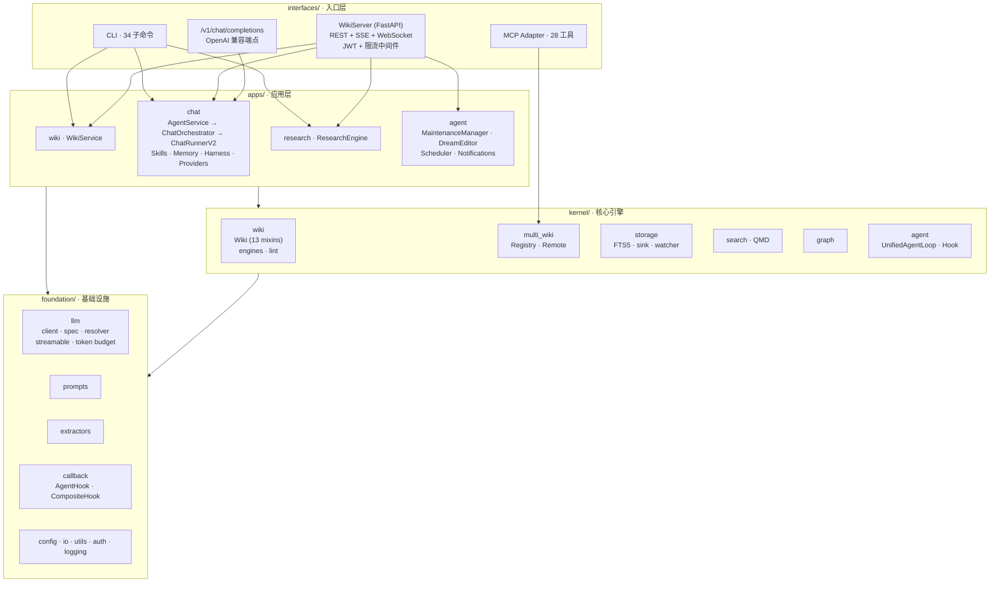
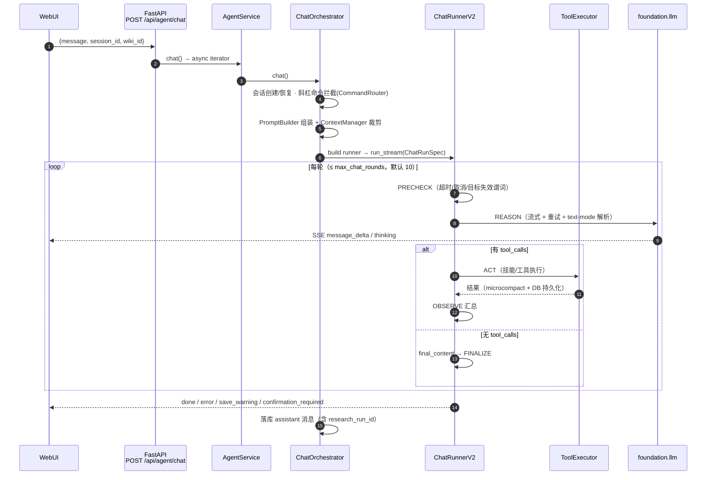
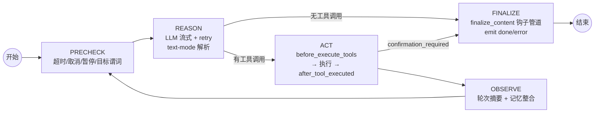
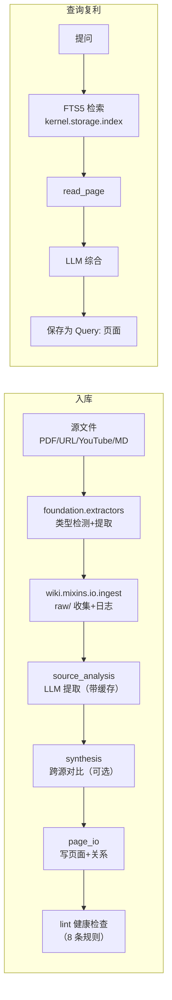
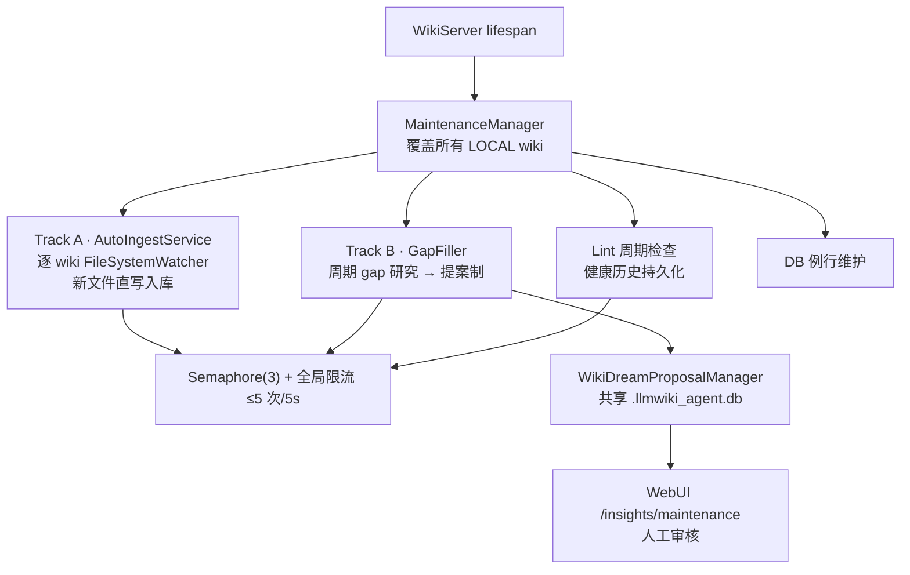
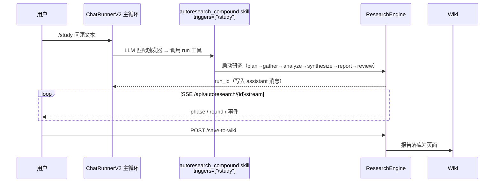

# llmwikify 架构与流程总览（图解版）

> 面向开发者的图示文档。文字版见 [ARCHITECTURE.md](../../ARCHITECTURE.md)。
> **版本:** 0.40.2 · **更新:** 2026-10-13 · **测试:** 4940 collected
> **验证:** `python scripts/check_architecture.py` → 0 violations

## 目录

- [1. 分层与依赖规则](#1-分层与依赖规则)
- [2. 整体架构图](#2-整体架构图)
- [3. Chat 主链路（SSE 时序）](#3-chat-主链路sse-时序)
- [4. ChatRunnerV2 状态机与 Hook](#4-chatrunnerv2-状态机与-hook)
- [5. 知识入库与查询复利](#5-知识入库与查询复利)
- [6. 自维护子系统（v0.41）](#6-自维护子系统v041)
- [7. `/study` 深度研究](#7-study-深度研究)
- [8. 入口层与运行时开关](#8-入口层与运行时开关)
- [9. 验证与维护](#9-验证与维护)

---

## 1. 分层与依赖规则

依赖方向严格单向，禁止反向（含 runtime lazy import）：

```
interfaces  →  apps, kernel, foundation
apps        →  foundation, kernel
kernel      →  foundation              ← 严格不依赖 apps
foundation  →  (self only)
```

backward-compat shim（保留旧导入路径，指向新家）：

| Shim | 指向 |
|------|------|
| `apps/chat/agent/unified/` | `kernel/agent/`（通用 agent 框架） |
| `apps/chat/agent/execution_context.py` | `kernel/agent/execution_context.py` |
| `apps/chat/engine.py`、`apps/chat/research_engine/` | `apps/research/`（研究引擎） |
| `kernel/quant/llm_client.py` | `foundation/llm/client.py` |

---

## 2. 整体架构图



规模：`src/llmwikify/` 约 400 个 py 文件 / 7.5 万行；`tests/` 约 236 个测试文件。

---

## 3. Chat 主链路（SSE 时序）



关键代码路径：

| 步骤 | 位置 |
|------|------|
| HTTP 入口 | `interfaces/server/http/agent/sessions.py` (`POST /chat`) |
| 组合根 | `apps/chat/agent/agent_service.py` (`AgentService`) |
| Chat 编排 | `apps/chat/agent/orchestrator.py` (`ChatOrchestrator`) |
| Agent 循环 | `apps/chat/agent/runner_v2.py` (`ChatRunnerV2`) |
| 工具执行 | `apps/chat/agent/tool_executor.py` + `apps/agent/tools/skill_adapter.py` |
| LLM 客户端 | `foundation/llm/client.py` → `foundation/llm/streamable.py` |

每轮 chat 动态组装：`CompositeHook[WikiHook, _V2PersistenceHook]` +
`SubagentManager`（子代理不能再生成孙代理）。`ChatRunSpec` 承载
microcompact（默认 ON，保留 1000 字符）等约 20 个字段。

### SSE 事件表（`apps/chat/agent/events.py`）

| Event | 含义 |
|-------|------|
| `message_delta` | LLM 内容增量 |
| `thinking` | 思维链 / reasoning |
| `tool_call_start` / `tool_call_end` / `tool_call_error` | 工具轮次执行 |
| `confirmation_required` | 等待用户确认（危险操作） |
| `compacted` | 工具结果被 microcompact |
| `session_created` / `session_init` | 会话生命周期 |
| `command_done` | 斜杠命令完成（绕过 LLM 循环） |
| `research_run_started` | `/study` 研究已启动 |
| `save_warning` | DB 写失败但流继续（`{type, reason}`） |
| `done` / `error` | 终止事件 |
| `phase` | 研究引擎域标记（透传） |

---

## 4. ChatRunnerV2 状态机与 Hook



13 个 `AgentHook` 钩子点（`foundation/callback/composite.py`）：

```
wants_streaming · before_iteration · on_stream · on_stream_end ·
emit_reasoning · emit_reasoning_end · before_execute_tools ·
after_tool_executed · on_tool_error · on_confirmation ·
after_iteration · finalize_content · on_error
```

`CompositeHook` fan-out 错误隔离（async 钩子自动 try/except log warning），
仅 `finalize_content` 透传异常（pipeline 语义）。业务钩子位于
`foundation/callback/integrations/`：`WikiHook` / `WikiDreamSyncHook` /
`AutoIngestHook`。

---

## 5. 知识入库与查询复利



---

## 6. 自维护子系统（v0.41）



同一 lifespan 还管理：

- **DreamScheduler**（cron，记忆梦境管线）
- **AutoCompact**（TTL 压缩，`memory_config.json` 可调）
- **ConfirmationsCleanup**（过期确认令牌清理）

全部走两级开关：服务构造开关 + 配置文件 `enabled` 标志。

---

## 7. `/study` 深度研究



要点：

- 触发条件只有显式 `/study` 前缀（`/api/health.features.research_trigger`）。
- 研究阶段由 `apps/research/gates.py` 质量门控制（源数量 / 类型多样性 / 可信度）。
- 长任务使用更长的 SSE 超时（研究 6 步流程默认超时不足）。

---

## 8. 入口层与运行时开关

### WebUI 路由（`ui/webui/src/App.tsx`）

```
/edit                     编辑器
/dashboard                知识增长
/insights                 洞察
/insights/dream           梦境提案
/insights/sink            Sink 队列
/insights/maintenance     自维护面板
/agent/chat               Agent 对话
/agent/autoresearch       深度研究
/agent/confirmations      确认中心
/agent/tasks              任务监控
/agent/settings           LLM 设置
/login                    JWT 认证
```

### `/api/health.features` 运行时开关

| Feature | 说明 |
|---------|------|
| `mcp` / `webui` / `auth` | 服务能力 |
| `multi_wiki` | 多 wiki 模式（>1 个注册 wiki 时为 true） |
| `dream_scheduler` / `auto_compact` | 后台任务运行状态 |
| `confirmations_cleanup` | 过期确认清理任务 |
| `maintenance` | 自维护管理器（v0.41） |
| `research_trigger` | 固定为 `/study` |

---

## 9. 验证与维护

```bash
python scripts/check_architecture.py     # 分层依赖检查：必须 0 violations
pytest --collect-only -q                 # 测试收集（4940，排除 tests/ab_testing）
pytest -m e2e                            # 端到端（需要真实服务）
curl http://localhost:8765/api/health    # 运行时健康检查
```

代码图谱（graphify）：

```bash
graphify update .    # 刷新 graphify-out/（无 API 成本）
```

> 维护约定：本文件是`ARCHITECTURE.md` 的图解伴生文档。
> 架构改动（新增/删除层内模块、改变主链路）时同步更新两处。
