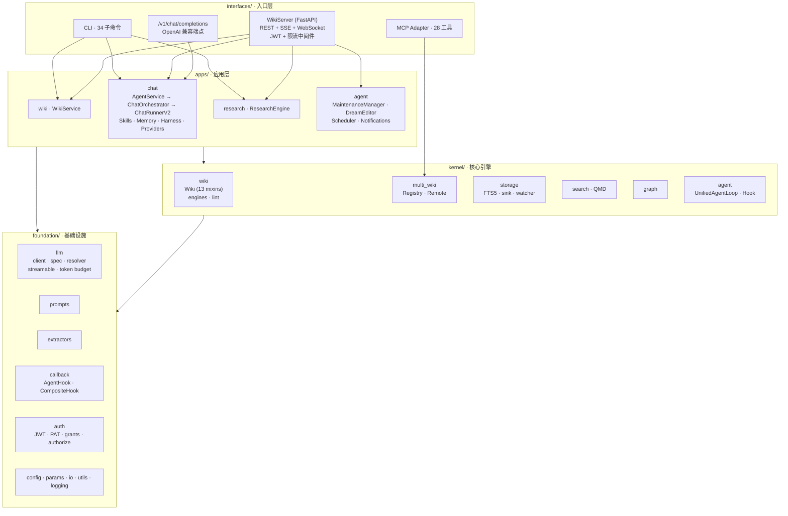
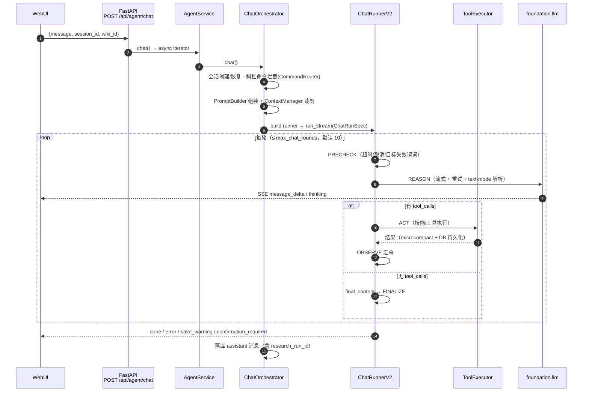
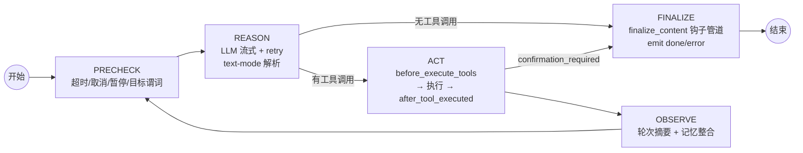
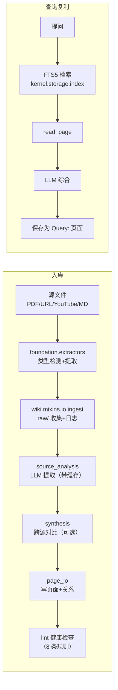
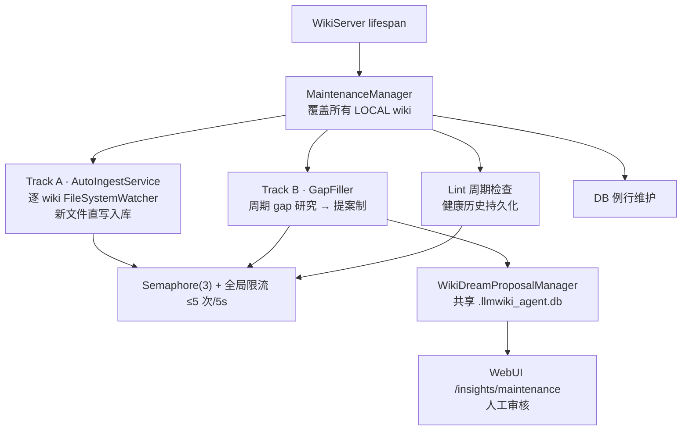
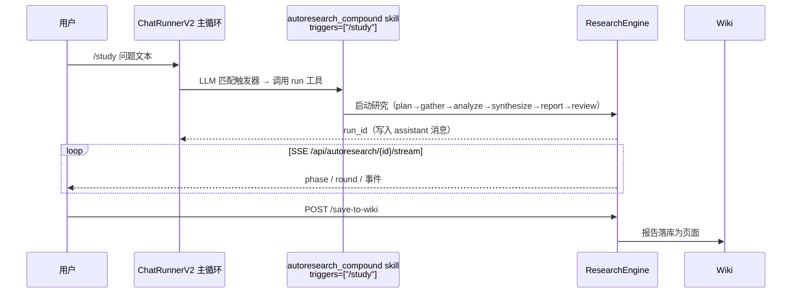
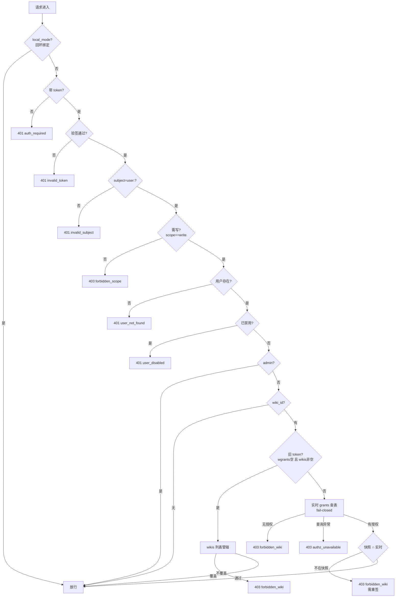

# llmwikify 架构与流程总览（图解版）

> 面向开发者的图示文档。文字版见 [ARCHITECTURE.md](../../ARCHITECTURE.md)。
> **版本:** 0.40.6 · **更新:** 2026-11-16 · **测试:** 5201 collected
> **验证:** `python scripts/check_architecture.py` → 0 violations

## 目录

- [1. 分层与依赖规则](#1-分层与依赖规则)
- [2. 整体架构图](#2-整体架构图)
- [3. Chat 主链路（SSE 时序）](#3-chat-主链路sse-时序)
- [4. ChatRunnerV2 状态机与 Hook](#4-chatrunnerv2-状态机与-hook)
- [5. 知识入库与查询复利](#5-知识入库与查询复利)
- [6. 自维护子系统（v0.41）](#6-自维护子系统v041)
- [7. `/study` 深度研究](#7-study-深度研究)
- [8. 多用户与授权模型](#8-多用户与授权模型)
- [9. 入口层与运行时开关](#9-入口层与运行时开关)
- [10. 验证与维护](#10-验证与维护)

---

## 1. 分层与依赖规则

依赖方向严格单向，禁止反向（含 runtime lazy import）：

```
interfaces  →  apps, kernel, foundation
apps        →  foundation, kernel
kernel      →  foundation              ← 严格不依赖 apps
foundation  →  (self only)
```

backward-compat shim（保留旧导入路径，指向新家）：

| Shim | 指向 |
|------|------|
| `apps/chat/agent/unified/` | `kernel/agent/`（通用 agent 框架） |
| `apps/chat/agent/execution_context.py` | `kernel/agent/execution_context.py` |
| `apps/chat/engine.py`、`apps/chat/research_engine/` | `apps/research/`（研究引擎） |
| `apps/chat/db.py` | `apps/chat_db/`（ChatDatabase） |
| `apps/agent/tools/__init__.py` | `apps/wiki/tool_registry.py` + `apps/chat/skills/` |

---

## 2. 整体架构图



规模：`src/llmwikify/` 415 个 py 文件 / 8.5 万行；`tests/` 244 个测试文件。

---

## 3. Chat 主链路（SSE 时序）



关键代码路径：

| 步骤 | 位置 |
|------|------|
| HTTP 入口 | `interfaces/server/http/agent/sessions.py` (`POST /chat`) |
| 组合根 | `apps/chat/agent/agent_service.py` (`AgentService`) |
| Chat 编排 | `apps/chat/agent/orchestrator.py` (`ChatOrchestrator`) |
| Agent 循环 | `apps/chat/agent/runner_v2.py` (`ChatRunnerV2`) |
| 工具执行 | `apps/chat/agent/tool_executor.py` + `apps/agent/tools/skill_adapter.py` |
| LLM 客户端 | `foundation/llm/client.py` → `foundation/llm/streamable.py` |

每轮 chat 动态组装：`CompositeHook[WikiHook, _V2PersistenceHook]` +
`SubagentManager`（子代理不能再生成孙代理）。`ChatRunSpec` 承载
microcompact（默认 ON，保留 1000 字符）等约 20 个字段。

### SSE 事件表（`apps/chat/agent/events.py`）

| Event | 含义 |
|-------|------|
| `message_delta` | LLM 内容增量 |
| `thinking` | 思维链 / reasoning |
| `tool_call_start` / `tool_call_end` / `tool_call_error` | 工具轮次执行 |
| `confirmation_required` | 等待用户确认（危险操作） |
| `compacted` | 工具结果被 microcompact |
| `session_created` / `session_init` | 会话生命周期 |
| `command_done` | 斜杠命令完成（绕过 LLM 循环） |
| `research_run_started` | `/study` 研究已启动 |
| `save_warning` | DB 写失败但流继续（`{type, reason}`） |
| `done` / `error` | 终止事件 |
| `phase` | 研究引擎域标记（透传） |

---

## 4. ChatRunnerV2 状态机与 Hook



13 个 `AgentHook` 钩子点（`foundation/callback/composite.py`）：

```
wants_streaming · before_iteration · on_stream · on_stream_end ·
emit_reasoning · emit_reasoning_end · before_execute_tools ·
after_tool_executed · on_tool_error · on_confirmation ·
after_iteration · finalize_content · on_error
```

`CompositeHook` fan-out 错误隔离（async 钩子自动 try/except log warning），
仅 `finalize_content` 透传异常（pipeline 语义）。业务钩子位于
`foundation/callback/integrations/`：`WikiHook` / `WikiDreamSyncHook` /
`RawFileScanHook`（仅探测 raw/ 新文件，不入库；入库走 maintenance
`AutoIngestService`）。

---

## 5. 知识入库与查询复利



---

## 6. 自维护子系统（v0.41）



同一 lifespan 还管理：

- **DreamScheduler**（cron，记忆梦境管线）
- **AutoCompact**（TTL 压缩，`memory_config.json` 可调）
- **ConfirmationsCleanup**（过期确认令牌清理）

全部走两级开关：服务构造开关 + 配置文件 `enabled` 标志。

---

## 7. `/study` 深度研究



要点：

- 触发条件只有显式 `/study` 前缀（`/api/health.features.research_trigger`）。
- 研究阶段由 `apps/research/gates.py` 质量门控制（源数量 / 类型多样性 / 可信度）。
- 长任务使用更长的 SSE 超时（研究 6 步流程默认超时不足）。

---

## 8. 多用户与授权模型

授权数据在 `~/.llmwikify/auth.db`（`LLMWIKIFY_HOME` 可隔离测试库），与 wiki 存储完全分离。
裁决集中在 `foundation/auth/authorize.py` 的纯函数 `authorize_request()`，中间件只做「取 token → 验签 → 调裁决」。

### 8.1 裁决顺序（短路求值）



| 决策 | 语义 |
|------|------|
| **D6=A** | 每请求查实时 grants 表 —— 撤权**下一请求即 403**；加权限**不追溯**老 token（需 `llmwikify auth token` 重签） |
| **旧 token 判定** | **值规则，非 schema 字段**：`wgrants` 空 **且** `wikis` 非空 → 旧 token（跳过 grants 检查）；`wgrants` 空 **且** `wikis == []` → 新签发的零授权 token（走实时检查，被拒） |
| **scope 上限先于用户存在性** | 只读 token 打在已删账号上，报 `forbidden_scope`（更精确）；scope = 快照含任一 `rw` ? `write` : `read` |
| **fail-closed** | 查表异常一律 403 `authz_unavailable`，不放行 |
| **只有 admin 隐含全权**（Q2） | 不做 wiki 属主概念；admin 早于 wiki 维度检查 → 能看到签发后新建的 wiki |
| **列表路由同源** | `/api/wikis`、`/api/search/cross` 返回 `accessible_wikis()` = 快照 ∩ 实时，避免「列得出但打开 403」 |

### 8.2 授权数据模型

`wiki_grants` 单表承载三种主体（K8s `subject.kind` 模式，D1/Q1）：

| principal_type | 语义 | 展开方式 |
|---|---|---|
| `user` | 单个用户对某 wiki 的权限 | 直接匹配 |
| `group` | 组对某 wiki 的权限 | 经 `group_members` 展开到成员 |
| `public` | PG `PUBLIC` 伪角色 | 所有登录用户 |

```sql
CREATE TABLE wiki_grants (
    principal_type TEXT NOT NULL CHECK (principal_type IN ('user','group','public')),
    principal_id   TEXT NOT NULL,
    wiki_id        TEXT NOT NULL,       -- '*' = 含未来新建 wiki（仅实时上界）
    can_read       INTEGER NOT NULL DEFAULT 0,
    can_write      INTEGER NOT NULL DEFAULT 0,
    granted_by     TEXT,
    created_at     TEXT NOT NULL DEFAULT (datetime('now')),
    PRIMARY KEY (principal_type, principal_id, wiki_id)
);
CREATE TABLE groups (id TEXT PRIMARY KEY, name TEXT UNIQUE NOT NULL, created_at TEXT);
CREATE TABLE group_members (group_id TEXT REFERENCES groups(id), user_id TEXT NOT NULL);
```

- **无 deny 行**：撤销 = 删行（D5）。
- **`wiki_id = '*'`** 只在实时上界里表示「含未来 wiki」；**token 快照永不存 `*`**，签发时展开为具体列表（Q3）→ 新建 wiki 需重签。
- `users.disabled_at` 软删用户；`share_tokens` 独立表（P6 数据层就绪，完整 share 功能归 roadmap Phase 3）。
- 性能：WAL + 线程本地复用连接，实测点查 **25–28 µs**（每次新开 `sqlite3.connect` 是 208 µs，8× 差距）。

### 8.3 管理面

| 面 | 入口 |
|---|---|
| CLI（admin 专属） | `llmwikify auth {create-user,list-users,disable-user,enable-user,grant,revoke,can-i,group create\|list\|add\|remove}` |
| HTTP · 自述 | `GET /api/auth/me` —— 当前用户对每个 wiki 的读/写权限矩阵 |
| HTTP · 管理（admin） | `GET/POST/DELETE /api/auth/grants` · `GET /api/auth/users` · `GET /api/auth/groups` |
| WebUI | `/agent/access` —— AccessControl 页（admin） |

`grant` / `revoke` 的 `--user` 与 `--group` **互斥**。设计与决策记录见
[docs/designs/multiuser-auth-design.md](../designs/multiuser-auth-design.md)，
实施记录见
[docs/summaries/2026-11-14-multiuser-auth-implementation-record.md](../summaries/2026-11-14-multiuser-auth-implementation-record.md)。

---

## 9. 入口层与运行时开关

### WebUI 路由（`ui/webui/src/App.tsx`）

```
/edit                     编辑器
/dashboard                知识增长
/insights                 洞察
/insights/dream           梦境提案
/insights/sink            Sink 队列
/insights/maintenance     自维护面板
/agent/chat               Agent 对话
/agent/autoresearch       深度研究
/agent/confirmations      确认中心
/agent/tasks              任务监控
/agent/settings           LLM 设置
/agent/access             访问控制（admin 授权管理）
/login                    JWT 认证
```

### `/api/health.features` 运行时开关

| Feature | 说明 |
|---------|------|
| `mcp` / `webui` / `auth` | 服务能力 |
| `multi_wiki` | 多 wiki 模式（>1 个注册 wiki 时为 true） |
| `dream_scheduler` / `auto_compact` | 后台任务运行状态 |
| `confirmations_cleanup` | 过期确认清理任务 |
| `maintenance` | 自维护管理器（v0.41） |
| `research_trigger` | 固定为 `/study` |

---

## 10. 验证与维护

```bash
python scripts/check_architecture.py     # 分层依赖 + 导入解析：0 violation / 0 broken import
pytest --collect-only -q                 # 测试收集（5201，排除 tests/ab_testing）
pytest -m e2e                            # 端到端（需要真实服务）
curl http://localhost:8765/api/health    # 运行时健康检查

python tools/exploit_check_wikis_claim.py   # 授权绕过探针：4/4 blocked
python tools/auth_defect_verify.py          # 已知 auth 缺陷复现脚本：4/4 NOT reproduced
```

代码图谱（graphify）：

```bash
graphify update .    # 刷新 graphify-out/（无 API 成本）
```

> 维护约定：本文件是`ARCHITECTURE.md` 的图解伴生文档。
> 架构改动（新增/删除层内模块、改变主链路）时同步更新两处。
>
> 最近更新：2026-11-16 —— 补入多用户授权模型（§8）、修正 shim 表、刷新规模与测试数字。
